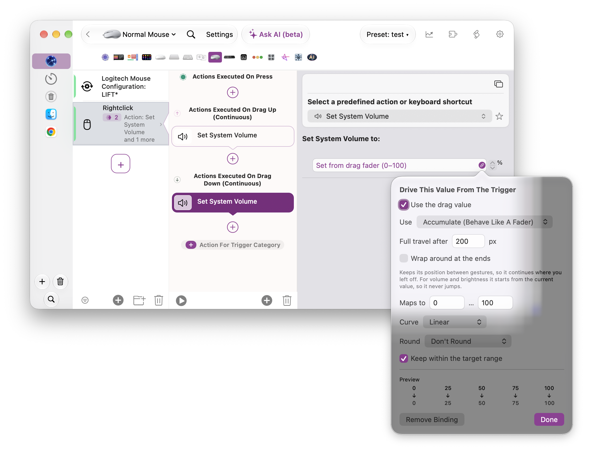
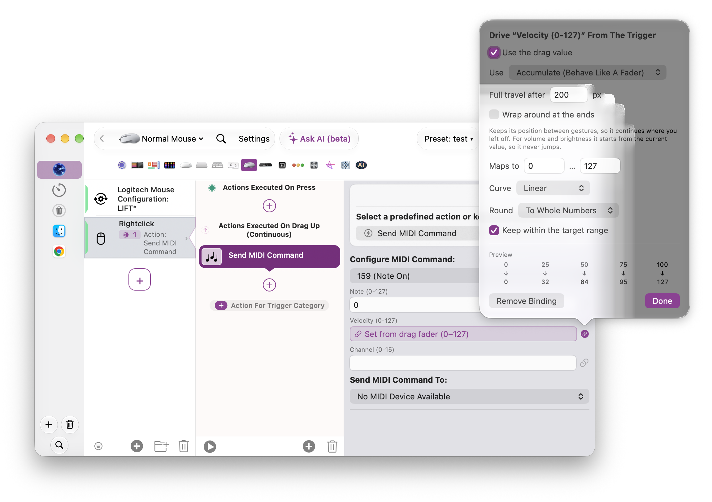

# Action Value Bindings

A value binding lets a trigger control an action's numeric field. For example, a trackpad swipe can adjust system volume, a mouse drag can send MIDI values, or a floating-menu slider can set brightness. You do not need a script to pass the value to the action.

Bindings are available for supported numeric fields when the action is attached to a trigger category that supplies a value. Look for the link icon beside the field. You can bind multiple supported fields in the same action separately, while leaving other fields at fixed values.

## Create a binding

1. Add your action to a category that supplies changing values: **While Moving (Continuous)** or a continuous direction for a [trackpad gesture](/docs/trackpad-mouse/continuous-gestures), or a **Drag … (Continuous)** category for a [mouse button](/docs/normal-mouse/continuous-drags). Pinch and rotation use **While Pinching** and **While Rotating**.
2. Click the link icon beside the field you want to control.
3. Enable **Use the swipe value**, **Use the drag value**, or the corresponding option for your trigger.
4. Choose **How to change the value** and set the **Output range**.
5. Choose the curve, rounding and range limit, then click **Done**.

The field displays a summary such as **Adjusted by swipe (0–100)**. Click its link icon to change the binding or choose **Remove Binding** to return to a fixed field value.

New bindings for continuous trackpad gestures and mouse drags default to **Increase / Decrease Value**. Existing saved bindings keep their selected mode. Other sources, such as MIDI and floating-menu sliders, default to **Set Value Directly**.

The screenshots show earlier labels; the instructions use the current control names.

## Choose the source

| How to change the value | Meaning | Typical use |
|---|---|---|
| **Increase / Decrease Value** | Adds signed movement to the current or remembered value. Reversing direction reverses the change. | Raise/lower volume, brightness or another value without restarting from the beginning of the range. |
| **Set Value Directly** | Maps the trigger's current value to the output range. For continuous trackpad gestures and mouse drags, this is 0–100 progress within the current stroke. | Map stroke progress, a slider's position or a MIDI value to an output range. |

For continuous trackpad gestures, **Set Value Directly** restarts when you reverse direction. It measures progress within the stroke, rather than an absolute finger position on the trackpad. **Increase / Decrease Value** continues from the current or remembered value when you reverse. With a **Linear** curve, up/right raises it and down/left lowers it; pinch out raises it and pinch in lowers it; counterclockwise rotation raises it and clockwise rotation lowers it.

Two additional source modes are available under **Advanced**:

| Advanced mode | Meaning |
|---|---|
| **Position (0…1)** | The trigger's position normalized to 0–1 before mapping to the output range. Useful for mapping different native ranges consistently. |
| **Change Since Last Update** | The signed change supplied by this update. Useful for actions that expect a change amount rather than an absolute setting. |

**Change Since Last Update** does not remember earlier movement or read the target's current setting. Use **Increase / Decrease Value** when relative movement should adjust an absolute setting such as **Set System Volume**.

The change still goes through **Output range**, the curve and the range limit. It is not an unmodified signed number: with the default input range and clamping, negative changes can map to the lower output bound.

## Mapping and sensitivity

- **Output range** sets the values sent to the action, for example **0 … 100** for volume or **0 … 127** for MIDI.
- **Curve** changes the response: **Linear**, **Inverted**, **Logarithmic**, or **Exponential**.
- **Round** offers **Don't Round** and **To Whole Numbers**. MIDI note, controller and velocity values generally need whole numbers.
- **Keep within the target range** prevents the mapped result from exceeding the selected range.

**Increase / Decrease Value** shows an **Output range preview** with the values the action can receive. **Set Value Directly** shows how trigger values map to that range. For example, a linear **0 … 127** mapping turns the midpoint into 63.5, or 64 when rounded to a whole number.

### Increase / Decrease settings

Choosing **Increase / Decrease Value** adds two controls:

| Setting | Meaning |
|---|---|
| **Movement for the full range** | Movement needed to traverse the complete output range. Defaults: **40 % of trackpad** for swipes/edge slides, **50 % magnification** for pinch, **90 degrees** for rotation, and **200 px** for mouse drags. Larger values make the control less sensitive. |
| **Wrap around at the ends** | Continues at the other end when movement passes an endpoint. Leave this off for volume and brightness. |

Movement already has a direction. **Inverted** reverses that direction again; leave the curve **Linear** for the usual up/right = higher, down/left = lower behavior.

For system output volume, input volume, display brightness and keyboard brightness, BTT can read the current setting and use it as the starting point when you begin using the control again. For targets it cannot read, such as an external MIDI device, it remembers the last value it sent. The starting point defaults to halfway through the range before applying the selected curve, and the remembered value is held in memory until BTT restarts. It cannot automatically follow changes made directly on an external device.

The trackpad trigger's full-value-range setting controls the progress used by **Set Value Directly** and **Advanced → Position (0…1)**. A binding using **Increase / Decrease Value** uses its own **Movement for the full range** setting instead.

For trackpad gestures, each bound action/category keeps its own remembered value. Use one action under **While Moving** when one MIDI value should move smoothly in both directions. Separate **Swipe Up** and **Swipe Down** actions have separate remembered values. Mouse drag bindings share a remembered value for matching fields under the same mouse-button trigger, which lets the two directional actions adjust one value.

## Example: send MIDI values from a gesture

1. Add **Send MIDI Command** under a trackpad gesture's **While Moving (Continuous)** category, or a mouse button's continuous drag category.
2. Choose the MIDI command, channel and destination as usual. For a controller command, choose its controller number.
3. Click the link icon beside the value field you want to change.
4. Enable the binding and choose **Increase / Decrease Value** for reversible control, or **Set Value Directly** to send progress within each stroke.
5. Set **Output range** to **0 … 127**, **Curve** to **Linear**, **Round** to **To Whole Numbers**, and enable **Keep within the target range**.

The selected numeric field now follows the gesture. Other fields, such as the channel or controller number, can remain fixed. Binding a note or velocity field works the same way when that field offers the link icon.

For mouse control in both directions, configure the action under both corresponding continuous drag categories. For trackpad control, one action under **While Moving** covers both directions.

## Supported value sources

| Source | Categories and values |
|---|---|
| Continuous trackpad swipe or edge slide | **While Moving**, continuous direction categories and **Gesture End**. Progress is 0–100; change is measured in percentage points of trackpad width/height. **Gesture Begin** does not offer field bindings. |
| Continuous pinch or rotation | **While Pinching/Rotating**, their direction categories and **Gesture End**. Progress is 0–100; change uses magnification percentage points for pinch or degrees for rotation. **Gesture Begin** does not offer field bindings. |
| Mouse drag | Directional drag categories, including their continuous versions. Progress is 0–100; change is measured in pixels along the active axis. Use continuous categories for ongoing control. |
| MIDI trigger | Incoming MIDI values, normally 0–127. |
| Floating-menu slider or knob | The item's configured value range, under its value-change categories. Knobs also supply values through their rotation categories. |

If a field has no link icon, check both the action field and its category. The field must support numeric bindings, and its category must supply a value. To repeat an action or keyboard shortcut that has no bindable field, use [Only Continue After Accumulating Movement / Value](/docs/actions/control-flow#repeat-actions-after-accumulating-movement).

## Variables and exported JSON

The same trigger values are available to string fields and scripts as `BTTTriggerValue`, `BTTTriggerValueNormalized`, `BTTTriggerValuePercent`, `BTTTriggerValueMIDI`, and `BTTTriggerValueDelta`. For swipes, a delta of **5** means 5% of the trackpad's width or height; for mouse drags it means 5 pixels. Pinch uses magnification percentage points and rotation uses degrees. These are not necessarily a 5% change in the action's target value.

For presets and scripts that create actions, see the [Action Value Bindings JSON reference](/docs/actions/action-definitions#action-value-bindings). The UI labels do not change the stored source keys: **Increase / Decrease Value** uses `"accumulated"`, and **Set Value Directly** uses `"value"`.
