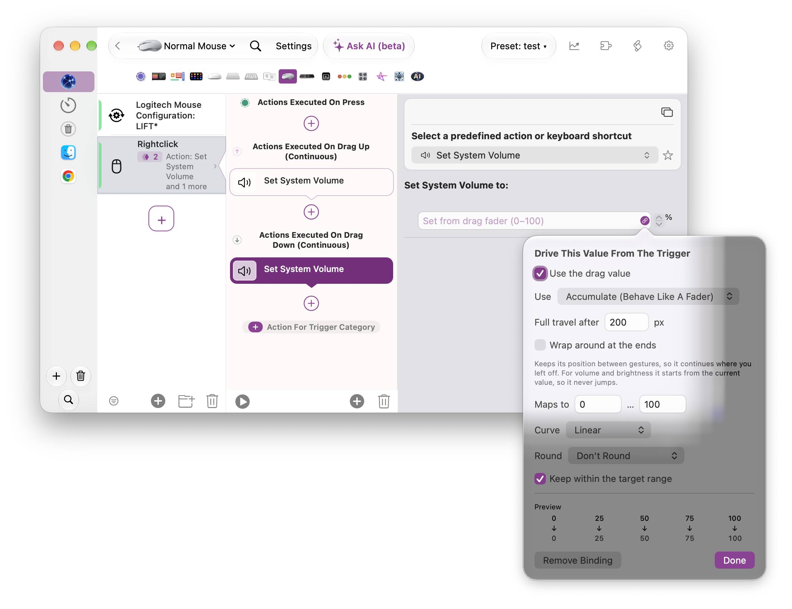

# Continuous Mouse Drags

Hold a mouse button and move the mouse to continuously control an action. With [Action Value Bindings](/docs/actions/value-bindings), you can turn a drag into a volume or brightness control, send changing MIDI values, or drive another supported numeric action field without writing a script.

Discrete drag categories trigger actions when a drag is recognized. Continuous categories keep supplying movement updates while you drag. Choose continuous categories for a smoothly changing value; for step-by-step shortcuts, you can add a movement threshold as described below.

## Example: hold a button and drag to adjust volume

1. Select **Normal Mouse**, add a trigger and record the mouse button you want to hold. See [Assigning Actions to Buttons](/docs/normal-mouse/assigning-actions) for the basic setup.
2. Use **Action For Trigger Category** to add **Actions Executed On Drag Up (Continuous)**.
3. Add **Set System Volume** to that category.
4. Click the link icon beside its volume field and enable **Use the drag value**.
5. Set **How to change the value** to **Increase / Decrease Value** and **Output range** to **0 … 100**. Keep **Curve** at **Linear**, enable **Keep within the target range**, and leave **Wrap around at the ends** off.
6. Add **Actions Executed On Drag Down (Continuous)** with another **Set System Volume** action using the same binding settings.
7. Hold the button and move up to raise volume or down to lower it. Release the button to stop.

New mouse-drag bindings default to **Increase / Decrease Value**; saved bindings keep their existing mode. Use the same **Linear** curve in both directions: movement already has a direction, so downward movement already lowers the value. You can set up left/right control with the corresponding categories instead.

The screenshot shows earlier labels; the instructions use the current control names.

## Adjust sensitivity and output

The **Movement for the full range** setting controls how far to drag for a full sweep of the target range. The default is **200 px**; **400 px** requires twice as much movement and gives finer control. This setting belongs to each binding, so use matching settings for the two directions of a volume control.

For smoother or less frequent updates, select the button trigger and open **Advanced → Continuous Drag Options → Continuous drag step threshold**. This sets the movement between action executions. **0** uses the global **Continuous Drag Step** in Normal Mouse settings, which defaults to **20 px**. A smaller step sends more frequent updates; it does not change the movement needed to cover the full output range.

**Increase / Decrease Value** keeps adjusting the current or remembered value across movement updates and reversals. For volume and supported brightness actions, BTT reads the current setting when you pick the control up again. **Set Value Directly** instead maps 0–100 progress within a drag stroke; it is useful when each stroke should sweep a range from its beginning.

To send MIDI, add **Send MIDI Command**, bind a supported field to **0 … 127**, and select **To Whole Numbers**. The [binding guide](/docs/actions/value-bindings) explains the source modes, response curves, remembered values and MIDI setup.

## Repeat actions by distance

To repeat a keyboard shortcut or an action that has no numeric field, add **Only Continue After Accumulating Movement / Value** before it in a continuous drag category.

For example, under **Drag Right (Continuous)**:

1. **Only Continue After Accumulating Movement / Value** with **Movement / Value Threshold** set to **30**.
2. A shortcut that selects the next tab.

Each accumulated 30 pixels of movement runs the shortcut once. Configure a separate threshold action and previous-tab shortcut under **Drag Left (Continuous)** to move the other way. The count depends on distance rather than the time spent dragging, unlike **Debounce**.

The threshold is checked when a drag update arrives, so the **Continuous drag step threshold** also affects when a step can execute. Partial accumulated mouse movement can carry over when you release the button and start another drag. See [Repeat actions after accumulating movement](/docs/actions/control-flow#repeat-actions-after-accumulating-movement) for details.

## Press, drag and release categories

Your button can also have press and release actions. Put the changing-value action in a **Drag … (Continuous)** category; an action under **Press** runs when you press the button and does not receive ongoing drag updates.

For smooth scrolling, zooming, rotation or space switching, BTT also has dedicated actions that simulate trackpad behavior. See [Using Drag Gestures to Simulate macOS Trackpad Gestures](/docs/normal-mouse/assigning-actions#using-drag-gestures-to-simulate-macos-trackpad-gestures).

For the touch equivalent, see [Fluid / Continuous Gestures](/docs/trackpad-mouse/continuous-gestures). Trackpad movement is measured as a percentage of the trackpad, while mouse-drag movement is measured in pixels.

## Script variables

Existing mouse-drag variables remain available: `BTTDragValue`, `BTTDragUpValue`, `BTTDragDownValue`, `BTTDragLeftValue`, `BTTDragRightValue`, `BTTDragDeltaX`, `BTTDragDeltaY` and `BTTDragButtonNumber`.

Bindings use the trigger's value directly. For shared variables and JSON configuration, see [Action Value Bindings](/docs/actions/value-bindings#variables-and-exported-json).
