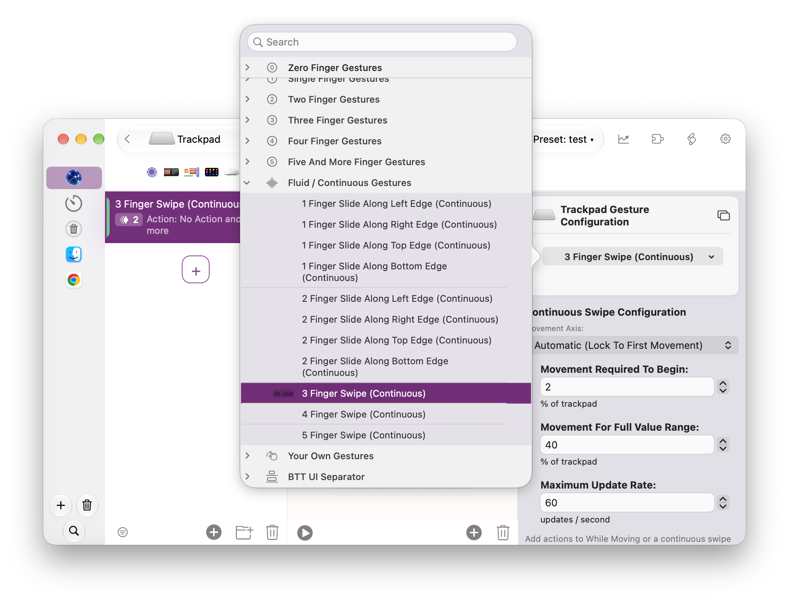
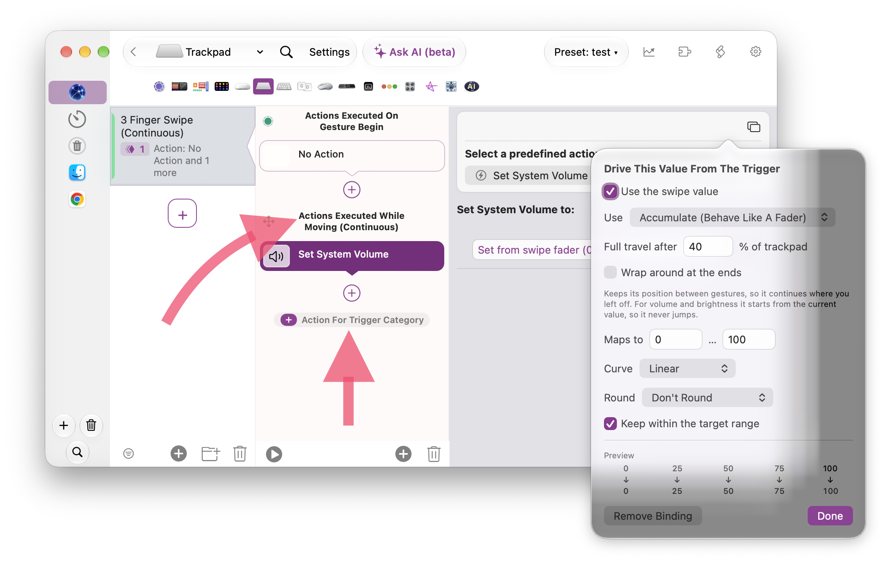
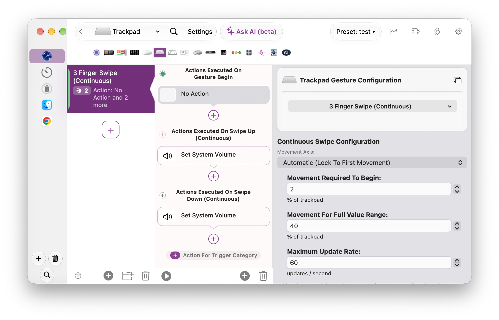

# Fluid / Continuous Gestures

Continuous gestures keep sending movement updates while your fingers move. You can use them to adjust volume or brightness, send changing MIDI values, or repeat a keyboard shortcut after a certain distance.

They are separate, optional gestures. Your existing taps, clicks, swipes and edge gestures keep their configuration and behavior. You can use both kinds together.

For the mouse equivalent, see [Continuous Mouse Drags](/docs/normal-mouse/continuous-drags). Both use the same [Action Value Bindings](/docs/actions/value-bindings) to connect movement to action fields without scripts.

## Available gestures

In **Trackpad**, add a trigger and open **Fluid / Continuous Gestures** in the gesture selector. These entries are also available in their usual finger-count sections; either location selects the same gesture.

| Gesture | Movement |
|---|---|
| **2 Finger Pinch (Continuous)** | Pinch out/in to adjust a value |
| **2 Finger Rotation (Continuous)** | Rotate two fingers counterclockwise/clockwise |
| **3 Finger Swipe (Continuous)** | Horizontal or vertical movement with three fingers |
| **4 Finger Swipe (Continuous)** | Horizontal or vertical movement with four fingers |
| **5 Finger Swipe (Continuous)** | Horizontal or vertical movement with five fingers |
| **1 Finger Slide Along Left / Right Edge (Continuous)** | Up/down along the selected edge |
| **1 Finger Slide Along Top / Bottom Edge (Continuous)** | Left/right along the selected edge |
| **2 Finger Slide Along Left / Right Edge (Continuous)** | Up/down along the selected edge with two fingers |
| **2 Finger Slide Along Top / Bottom Edge (Continuous)** | Left/right along the selected edge with two fingers |

These gestures require a built-in MacBook trackpad or an Apple Magic Trackpad. The continuous entries described here are not Magic Mouse gestures.

## Example: swipe up and down to adjust volume

1. Add **3 Finger Swipe (Continuous)** in the app or **All Apps** configuration where you want to use it.
2. In **Continuous Swipe Configuration**, set **Movement Axis** to **Vertical**.
3. Use **Action For Trigger Category** to add **Actions Executed While Moving (Continuous)**.
4. Add **Set System Volume** to that category.
5. Click the link icon beside the volume field and enable **Use the swipe value**.
6. Set **How to change the value** to **Increase / Decrease Value**, **Output range** to **0 … 100**, and **Curve** to **Linear**. Keep **Keep within the target range** enabled and **Wrap around at the ends** disabled. Leave **Movement for the full range** at **40 % of trackpad** to start.
7. Lift all fingers, then place three fingers and move them up or down. Up raises volume; down lowers it. You can reverse without lifting.

For three-finger swipes, native three-finger dragging must be disabled in macOS Accessibility settings. See [Compatibility and troubleshooting](#compatibility-and-troubleshooting) below.

New continuous-trackpad bindings default to **Increase / Decrease Value**; saved bindings keep their existing mode. Volume control starts from the current system volume. The small movement needed to recognize the gesture does not immediately jump volume to a new value.

The binding screenshot shows earlier labels; the instructions use the current control names.

## Example: pinch or rotate to adjust a value

Enable the corresponding **Zoom in or out** or **Rotate** gesture in macOS Trackpad settings so BTT receives its native events. Add **2 Finger Pinch (Continuous)** or **2 Finger Rotation (Continuous)**. Under **Actions Executed While Pinching (Continuous)** or **Actions Executed While Rotating (Continuous)**, add **Set System Volume** and bind its volume field using **Increase / Decrease Value**, mapped to **0 … 100**.

Pinching out raises the value; pinching in lowers it. Counterclockwise rotation raises it; clockwise rotation lowers it. You can reverse without lifting. Use the separate **Pinch Out / In** or **Counterclockwise / Clockwise Rotation** categories when the two directions should execute different actions. If both the general and matching direction category contain actions, both execute.

| Setting | Pinch | Rotation |
|---|---|---|
| Initial movement required | 2 magnification percentage points | 3 degrees |
| Trigger movement for the full progress range | 50 magnification percentage points | 90 degrees |
| Default binding movement for the full range | 50 magnification percentage points | 90 degrees |

Pinch uses the magnification change reported by macOS, rather than distance across the trackpad. Rotation uses degrees. The binding's **Movement for the full range** setting adjusts sensitivity independently of the trigger's **Movement For Full Value Range** setting. **Set Value Directly** maps 0–100 progress and restarts on reversal; **Increase / Decrease Value** continues from the current or remembered value.

The movement-threshold action works here too: for example, put **Only Continue After Accumulating Movement / Value**, with a threshold of **10**, before a shortcut in a rotation direction category to execute it every additional 10 degrees after activation.

Lift all fingers before trying a newly configured gesture, and keep exactly two fingers touching. An eligible continuous pinch blocks native zoom; an eligible continuous rotation blocks native rotation. Existing discrete BTT pinch/rotation actions can still execute alongside it. Configuring only pinch does not claim rotation, or vice versa.

<!-- Screenshot placeholder: a continuous rotation trigger with While Rotating, clockwise and counterclockwise categories, and the value-binding popover showing degrees. -->

## When actions run

Use the action-category button to add the parts of the gesture you need:

| Action category | When it runs |
|---|---|
| **Gesture Begin** | Once, after the required initial movement |
| **While Moving (Continuous)** | During movement in either direction on the chosen axis |
| **Swipe Up / Down / Left / Right (Continuous)** | During movement in that direction |
| **While Pinching / Rotating (Continuous)** | During either direction of the chosen transform |
| **Pinch Out / In; Counterclockwise / Clockwise Rotation (Continuous)** | During the named direction |
| **Gesture End** | Once when the active gesture ends normally by lifting fingers |

Use **While Moving** for one value that should go up and down, such as volume. Use direction categories for different actions, such as a next-tab shortcut on rightward movement and a previous-tab shortcut on leftward movement. Edge slides offer only the two directions along their edge.

If you assign actions to both **While Moving** and a matching direction category, both sequences run. **Gesture End** does not run when the gesture is interrupted, for example by a click or force press.

## Adjusting the gesture

For swipes and edge slides, select the trigger to edit **Continuous Swipe Configuration**:

| Setting | Default | Effect |
|---|---|---|
| **Movement Axis** | Automatic (Lock To First Movement) | Locks to the first dominant direction until the gesture ends. Choose Horizontal or Vertical for a dedicated control. Edge slides have a fixed axis. |
| **Movement Required To Begin** | 2% of trackpad | How far to move before the gesture starts. Increase it if small unintended movements start the gesture. |
| **Movement For Full Value Range** | 40% of trackpad | Travel corresponding to the full 0–100 range when using **Set Value Directly** or **Advanced → Position (0…1)**. |
| **Maximum Update Rate** | 60 updates/second | Limits how often movement updates are sent. Lower it if an assigned action needs fewer updates. |

Movement is measured from the average finger position, as a percentage of the trackpad's width or height. Using more fingers does not multiply the value. **Increase / Decrease Value** has its own sensitivity setting, **Movement for the full range**, in the binding popover.

## Sliding along an edge

For example, choose **1 Finger Slide Along Left Edge (Continuous)** and configure volume exactly as above. Its axis is already vertical.

Start a fresh touch with a finger in the outer 6% of the selected edge, then slide along it. Moving from the middle of the trackpad into the edge does not start an edge slide. For a two-finger slide, at least one finger must start at the edge, and both fingers must move along it to activate the gesture.

Moving too far away from the edge interrupts the slide: at least one finger must remain within 12% of the edge for one-finger slides, or 15% for two-finger slides. Lift all fingers before starting again. If you configure adjacent edges, start away from the corner so only one edge matches.

Pointer movement and native scrolling can still occur while using edge slides. These continuous gestures do not lock the pointer or suppress macOS gestures.

## Bind other action fields

The link icon beside a supported action field opens its binding options. You can map movement to a target range, change the response curve and round the result. For example, bind a **Send MIDI Command** value to **0 … 127** with **To Whole Numbers** enabled.

See [Action Value Bindings](/docs/actions/value-bindings) for the differences between **Increase / Decrease Value** and **Set Value Directly**, the **Position (0…1)** and **Change Since Last Update** options under **Advanced**, and a MIDI example.

## Repeat a shortcut or discrete action by distance

For actions without a bindable numeric field, put **Only Continue After Accumulating Movement / Value** before the actions you want to repeat.

For example, under **Swipe Right (Continuous)**, add that action with a **Movement / Value Threshold** of **5**, followed by a next-tab keyboard shortcut. Add a separate threshold action and previous-tab shortcut under **Swipe Left (Continuous)**.

After the gesture activates, each additional 5% of trackpad travel runs the following actions once. Moving slowly or quickly covers the same distance and produces the same number of steps. This differs from the time-based **Debounce** action.

See [Repeat actions after accumulating movement](/docs/actions/control-flow#repeat-actions-after-accumulating-movement) for remainder and reversal behavior.

## Compatibility and troubleshooting

- **Existing gestures can coexist.** If a movement also matches an existing discrete gesture, both can execute. Use different finger counts, modifier keys, app assignments or trigger conditions when you want to keep the actions separate.
- **Three-finger dragging blocks the three-finger continuous swipe.** Disable it in macOS Accessibility settings before using that gesture. Four-/five-finger swipes and edge slides do not have this restriction.
- **Native scrolling is blocked for matching three-/four-/five-finger continuous swipes**, including momentum after lifting your fingers. Normal two-finger scrolling and one-/two-finger edge slides retain their native behavior.
- **Continuous pinch and rotation block the matching native effect.** The gesture must match the current app, device, modifiers and conditions. Unmatched zoom/rotation and ordinary two-finger scrolling retain their native behavior.
- **macOS gestures can still execute.** Disable conflicting system swipe assignments if you do not want their effects alongside your BTT actions.
- **Keep the finger count stable after activation.** Lifting a finger ends the active swipe; adding an extra finger interrupts it. Lift all fingers before starting another gesture. Existing thumb/accidental-touch filtering affects the finger count recognized for three-/four-/five-finger swipes.
- **Avoid overlapping copies of the same continuous trigger.** If more than one eligible configuration matches the same gesture, BTT does not start that continuous stream. Different finger counts and different edges can be configured together. Pinch and rotation can also be configured together.
- **No link icon?** Select an action in **While Moving**, **While Pinching**, **While Rotating**, or a continuous direction category and use a numeric field that supports bindings. An action under **Gesture Begin** is not a continuous value binding target.
- **Value jumps or restarts when you reverse?** Choose **Increase / Decrease Value** to keep adjusting the current or remembered value. **Set Value Directly** maps progress within a stroke and restarts on reversal.
