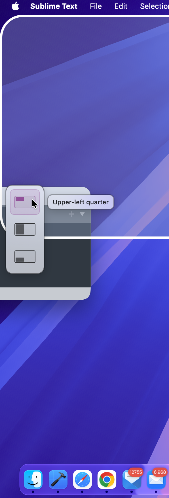
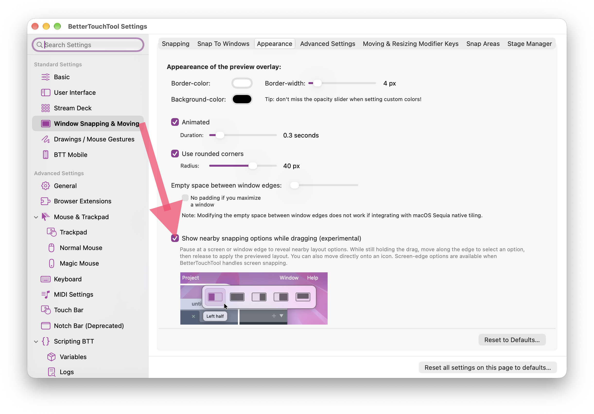
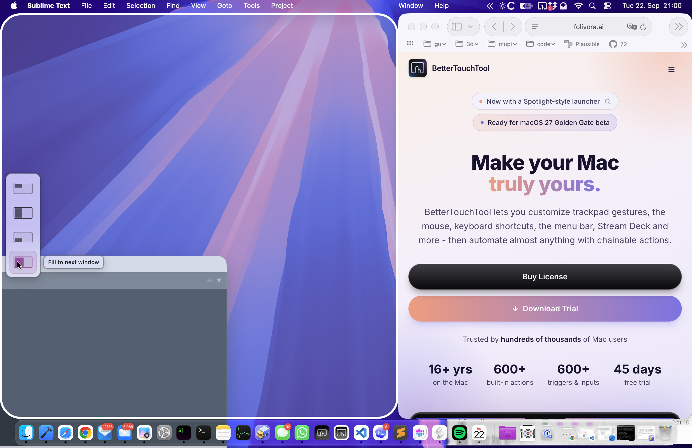
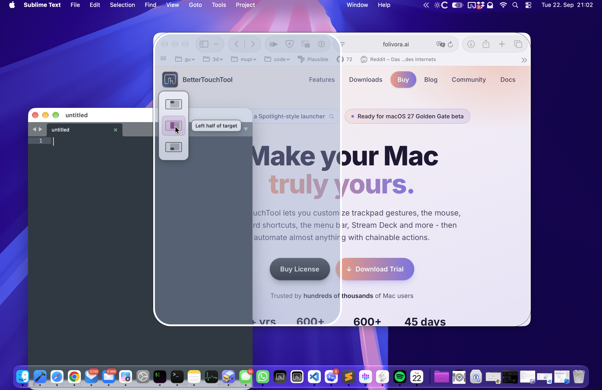
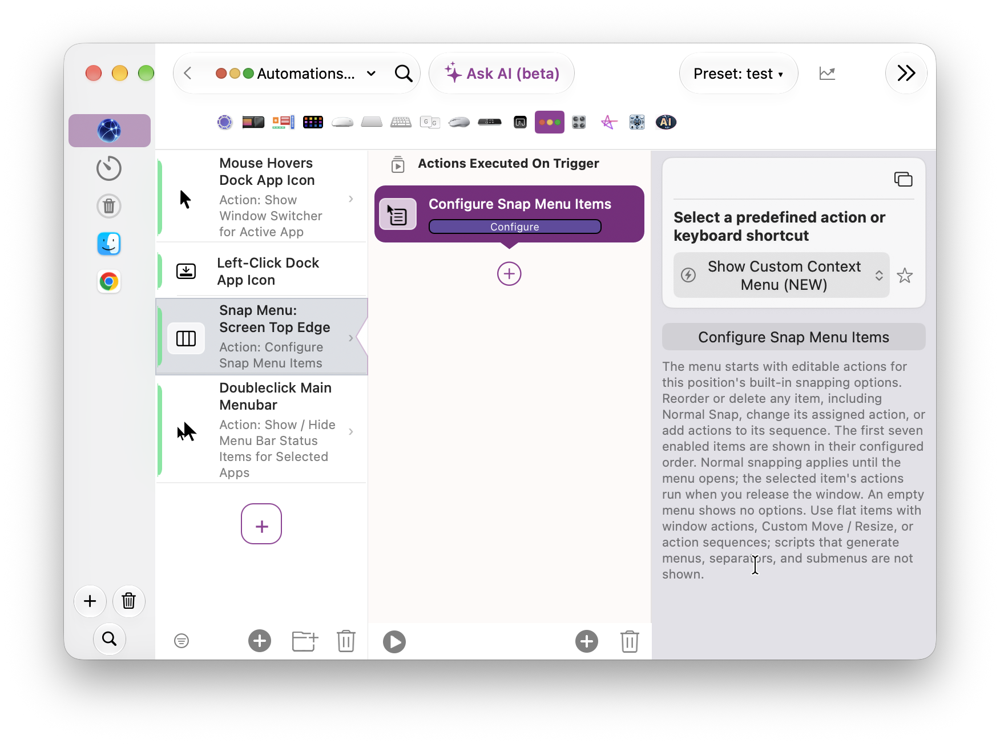
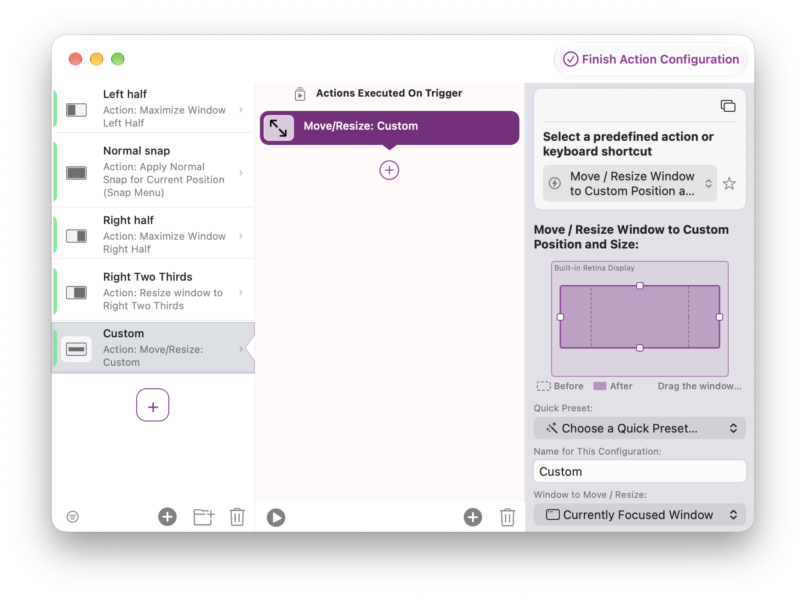

{/* Screenshot placeholders below can be replaced with Markdown images using the suggested /media/... paths. Add the corresponding image files to static/media/. */}

# Window Snapping Menus

By default, snapping menus appear when you drag a window and the mouse cursor reaches an edge or corner of the screen. After a brief pause, a small menu appears beside the cursor with alternative window layouts. Keep holding the drag, move along the edge to select a layout, then release to apply it. No keyboard modifiers are required.

You can use the default menus immediately, or customize the menu for each snapping position with window-resizing actions and other BetterTouchTool actions.

## Snapping menu settings

Snapping menus are enabled by default, so no setup is needed to use the default menus. You can turn them off or back on under **Settings → Window Snapping & Moving → Appearance → Show nearby snapping options while dragging (experimental)**. If you previously disabled this option, it stays disabled until you turn it back on.

Window snapping itself must also be enabled. Screen-edge menus are available when BetterTouchTool handles dragging to screen edges.

If macOS handles edge dragging, turn off **System Settings → Desktop & Dock → Windows → Tile by dragging windows to screen edges**. Choosing **Use Classic BetterTouchTool Resizing** in BTT alone does not change that macOS setting.

You do **not** need to enable **Snap To Windows** to use menus at screen edges, including the **Fill to next window** option described below.

## Choose a layout while dragging

1. Drag a window until the pointer reaches an enabled screen edge or corner. BetterTouchTool shows its usual snapping preview.
2. Pause briefly to reveal the snapping menu. In the default menu, the normal snapping option is initially selected.
3. Keep holding the drag and move **along the edge** to select another option: up/down beside a left or right edge, or left/right along the top edge. You can also move directly onto an icon.
4. Release the mouse button to apply the selected layout.

Releasing before the menu appears keeps the usual quick snapping behavior. Moving away from the snapping area dismisses the menu so you can continue dragging normally. Moving past the end of the menu keeps its nearest end item selected until you leave the snapping area or reach another snapping position.

The default choices depend on where you drag. For example, a left-edge menu offers the left half and the two left quarters. At the top screen edge, it offers the left half, the normal maximized destination, and the right half. Your configured snapping sizes and window spacing are taken into account.

## Fill the space beside an existing window

The default screen-edge menus can also offer **Fill to next window**. This uses the positions of other windows to find a useful destination.

For example, if an existing window occupies the right 35% of the screen, drag another window to the **left screen edge** and select **Fill to next window**. The dragged window fills the available space up to the existing window—approximately the remaining 65%, with your configured spacing applied. The proportions are calculated from the actual window positions.

At a screen corner, this option finds the largest available rectangle starting from that corner. It can be limited by more than one neighbouring window.

BetterTouchTool considers normal windows on that display that are not covered by other application windows, ignoring the window you are dragging. A neighbour may extend underneath the Dock or menu bar and still provide a boundary. The new destination stays within the usable desktop area.

The automatic menu only adds this option when there is a suitable neighbouring window and the result differs from its other choices. Existing custom menus keep their saved items; add **Fill to Next Window (Snap Menu)** to include it in one of those menus.

## Menus at the edges of other windows

To use a window itself as a snapping target, open **Settings → Window Snapping & Moving → Snap To Windows** and enable **Enable snapping to the edges of other windows**.

While dragging, the target window can be highlighted with an outline if that setting is enabled. Moving to one of its edges or corners offers a preview and, after a short pause, a snapping menu:

- **Inside the target window**, destinations divide or fill the target's rectangle when **Treat the inside of the target window like its own little display** is enabled. For example, the inside top-center menu offers its left half, the normal full-target destination, and its right half.
- **Outside the target window**, destinations fill space beside it. Depending on the edge, you can match the target's width or height, divide that space into segments, or use the other fill mode to extend across the available screen space.

If the Option-key fill-mode toggle is enabled, holding **⌥** temporarily changes the outside fill mode. The menu's **Other fill mode** choice also makes this available without a keyboard press.

Screen-edge snapping and [Custom Snap Areas](/docs/window-snapping/snap-areas) take precedence when you reach them.

## Customize a menu

Each screen or window snapping position can have its own menu. These are configured through triggers in BetterTouchTool's main configuration window.

1. Select **Automations, Named & Other Triggers**.
2. Choose **All Apps** for a shared menu, or select the application whose window you will drag for an app-specific menu.
3. Add a trigger. In the **Window Snapping Menus** category, choose a position such as **Snap Menu: Screen Left Edge** or **Snap Menu: Window Top Edge**.
4. BetterTouchTool automatically assigns **Configure Snap Menu Items**. Select that action and open its menu-item editor.
5. Edit the menu items and their assigned actions, then click **Finish Action Configuration** to return to the main configuration window.

Screen triggers cover the top, left, and right edges and all four corners. Window triggers also include the bottom edge. Choose a **Screen** trigger for dragging to a display boundary and a **Window** trigger for dragging to another window's boundary. A Window trigger applies both inside and outside that target edge.

An app-specific menu takes precedence over a menu in an active Conditional Activation Group, which in turn takes precedence over **All Apps**. The application is always the one whose window you drag. If no matching custom menu exists, BetterTouchTool uses the default menu.

Keep **Configure Snap Menu Items** as the action on the Snap Menu trigger. Add the actions you want to run to the individual menu items inside its editor.

### Arrange the items and assign actions

A new menu starts with the default options for its position, including their assigned actions. You can:

- Drag items into a different order, including before or after **Normal snap**.
- Rename or delete default items.
- Add items with standard window actions, such as **Maximize Window Left**, quarter or third sizes, or **Move / Resize Window to Custom Position and Size**.
- Replace an item's action, or add more actions to its sequence.
- Assign your own image or SF Symbol. Recognized resizing actions otherwise get a layout preview icon, also shown beside the item in the editor.

The item order in the editor is the order shown in the menu: top to bottom for a vertical menu, or left to right for a horizontal one. The item with the single **Apply Normal Snap for Current Position (Snap Menu)** action is selected when the menu first appears, even if you rename it. If you delete that item, replace its action, or add other actions to its sequence, the first available item becomes the initial selection.

For a simple starting point, customize the top screen-edge menu to contain **Left half**, **Normal snap**, **Right half**, and a new **Left third** item. Assign a left-third resizing action to the new item and drag it into the position where you want it to appear.

Menus currently show up to **seven items**. Use ordinary menu items; submenus, separators, and script-generated menu contents are not supported by the snapping menu. You can still assign a script action to an item to run it on release.

### Actions run when you release

An item's actions run when you **release the dragged window**, never just because you hover over its icon. Built-in window-moving and resizing actions run against the window being dragged; a script that chooses its own window still controls its own target.

A single supported resizing action can show a destination preview. Use **Move / Resize Window to Custom Position and Size** (Custom Move/Resize) when you need a size or position beyond the standard layouts. For a straightforward screen-edge preview, target one window and use a monitor reference on the same display where you are dragging, without cycling or restore toggles.

You can also give an item an action sequence—for example, resize the window and then run another action—or use an item just to run an action. Sequences and actions without a predictable destination may show an action icon instead of a resize preview. They still run on release.

## Actions that follow the current snapping position

Standard window actions select a named layout, such as a screen half or third. The following actions instead use the screen, target window, and snapping position that opened the menu. This lets an item keep its meaning when the target window moves or the menu opens on another display.

All names below have the suffix **(Snap Menu)** in the action picker.

| Action | Behavior |
| --- | --- |
| **Apply Normal Snap for Current Position** | Applies the usual destination for the screen or window edge/corner that opened the menu, respecting the current snapping settings. Use this for a **Normal snap** item. |
| **Fill to Next Window** | At a **screen** edge or corner, fills the available space up to a suitable neighbouring window. Works with **Snap To Windows** disabled. A simple item using this action is omitted when no suitable destination is available. |
| **Snap to Upper / Left Segment of Target** | At another window's left/right edge, chooses the upper segment; at its top/bottom edge, the left segment. At the inside top-center position, this is the target window's left half. |
| **Snap to Unsplit Target Edge** | Uses the undivided destination at the target-window edge instead of one of its upper/lower or left/right segments. |
| **Snap to Lower / Right Segment of Target** | At another window's left/right edge, chooses the lower segment; at its top/bottom edge, the right segment. At the inside top-center position, this is the target window's right half. |
| **Snap to Opposite Segment of Target** | Chooses the other end of the current target-window edge when the menu opened near a corner. From the middle of an edge, chooses its upper or left segment. |
| **Use Other Fill Mode Beside Target** | At an **outside** window edge, switches between matching the target's width/height and using the full available screen extent. It follows the current fill mode, including a temporary Option-key change. |

The five target-window actions require a **Window** snapping position. **Use Other Fill Mode Beside Target** additionally requires an outside edge. Unavailable destinations are omitted from simple resize menus.

These actions need the context of a snapping-menu selection. Assigned directly to an ordinary keyboard shortcut or gesture, they do nothing. For standalone shortcuts, use the usual [window-moving and resizing actions](/docs/window-snapping/gestures).

## If a menu or item is missing

- **No screen-edge menu:** Check **Enable window snapping** and the nearby-options setting, and turn off macOS's **Tile by dragging windows to screen edges** option. Pause briefly at an enabled snapping edge or corner while holding the drag.
- **No menu at another window:** Enable **Snap To Windows** and check that you are at the target window's edge. For menus inside its boundary, also enable **Treat the inside of the target window like its own little display**.
- **No Fill to next window item:** There must be a suitable neighbour leaving enough space. In an automatic menu, a destination identical to another choice does not get a duplicate item. In an existing custom menu, add the action yourself.
- **An app-specific menu is not used:** Configure it for the app whose window you are dragging, and check that its trigger and preset are enabled. If there is no app-specific menu, BetterTouchTool checks active Conditional Activation Groups and **All Apps** before using the defaults.
- **An item has no size preview:** Check its assigned action. A compound sequence, conditional action, or action that does not describe a supported window destination can still run when you release, without a rectangle preview.

To go back to the automatic menu for a position, disable or remove the applicable **Snap Menu: …** triggers, including any overrides in **All Apps** or active Conditional Activation Groups. Removing every item from an active custom menu leaves that menu empty; it does not restore the default items.
